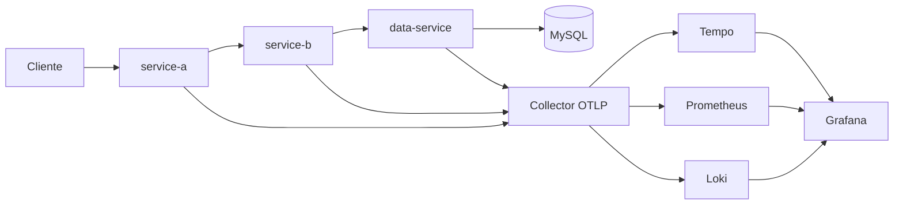

# Arquitectura de Lab 3.3

## Flujo de negocio

`GET /api/orders/{orderId}` entra en service-a. Ese servicio no toca la base. Llama a service-b en `GET /api/fulfillment/{orderId}`. service-b, si el experimento de latencia está encendido y el proceso está armado, duerme 200 ms dentro del span `fulfillment.prepare` y luego llama a data-service en `GET /api/records/orders/{orderId}`. data-service hace el `JOIN` de `orders` e `inventory`. La respuesta dice si `available >= quantity`.

## Perfiles de base de datos

| Perfil | Quién lo usa | URL |
|---|---|---|
| `local` | Compose y el MySQL del manifiesto GKE | `SPRING_DATASOURCE_URL` hacia MySQL del entorno |
| `gcp` | Solo si existe Cloud SQL | `CLOUD_SQL_JDBC_URL`, sin valor por defecto |
| `aws` | La tarea ECS | `RDS_JDBC_URL` (RDS si `create_rds=true`, sidecar si no) |

Un proceso no abre las dos bases cloud a la vez. El Compose local no usa los perfiles `gcp` ni `aws`. El MySQL de Docker no simula Cloud SQL ni RDS.

## Caos

`CHAOS_ARMED` nace en `false`. Aunque alguien llame a `POST /api/chaos/latency`, el servicio responde 409. Con el override `deploy/local/docker-compose.chaos.yml` el proceso queda armado, pero la latencia y el 10 % de errores siguen apagados hasta un POST con `X-Lab-Token` y `X-Lab-Enable: true`. El error solo afecta a peticiones que además traen `X-Lab-Experiment: error-rate`. `POST /api/chaos/stop` apaga las dos inyecciones sin redesplegar.

## Señales

El agente crea los spans HTTP y JDBC. Los spans manuales son `order.coordinate`, `fulfillment.prepare` y `record.load`. No hay un span manual de SQL.

La regla correlacionada exige a la vez:

- `error_rate` de data-service, ruta `/api/records/`, ventana 2 minutos, por encima de `avg_over_time` de 10 minutos más dos desviaciones estándar;
- p99 de service-a, ruta `/api/orders/`, por encima de 150 ms;
- al menos 8 muestras de la serie en 10 minutos, para no disparar al arrancar.

El umbral de latencia es 150 ms. Está elegido para que la inyección controlada de 200 ms lo cruce y para que el procesamiento de esta consulta, sin inyección, quede por debajo. El p99 sano de este laboratorio todavía no se midió con el stack en ejecución: 150 ms es un umbral de diseño, no un percentil observado. El SLO de éxito es 99 % de respuestas 2xx en `/api/orders/`.

Prometheus no lleva `trace_id` en esas series. `observability/aiops/enrich_incident.py` busca en Loki una línea reciente y, si la encuentra, publica el id. Si no, el incidente dice que no hay traza relacionada.

## Red y seguridad

En local, norte-sur es el HTTP de service-a y este-oeste es `http_client_request_duration` del agente. `POST /api/session` con un token distinto del configurado responde 401, suma `auth.failures` y escribe `autenticacion rechazada` sin el token.

App Mesh no se usa: el soporte terminó el 30 de septiembre de 2026. En GKE el mesh vigente es Cloud Service Mesh y no está aplicado. En ECS, Service Connect es la alternativa y tampoco está aplicado: la tarea de laboratorio habla por `127.0.0.1`. VPC Flow Logs sí están en el Terraform de AWS y en la subred de GCP, pero no se han creado recursos.

No hay fuente de CVE. El tablero de seguridad lo dice en un panel de texto y no muestra un número inventado.
